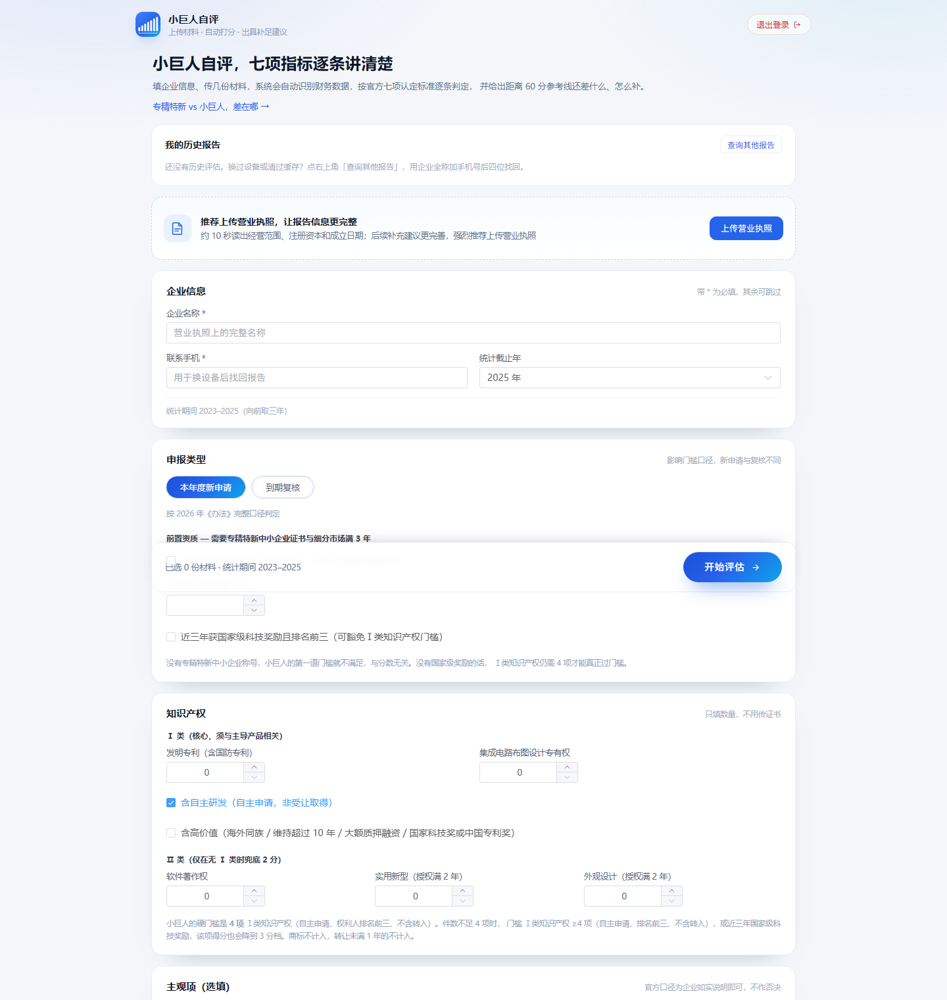
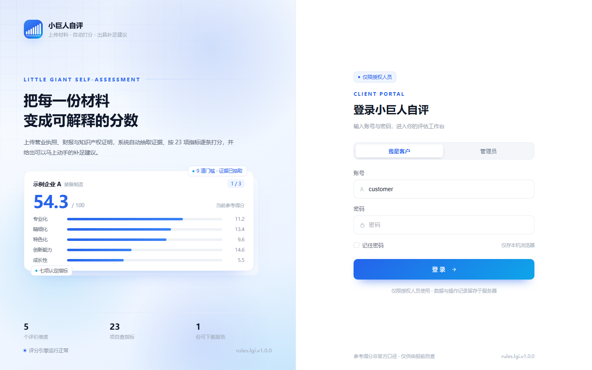
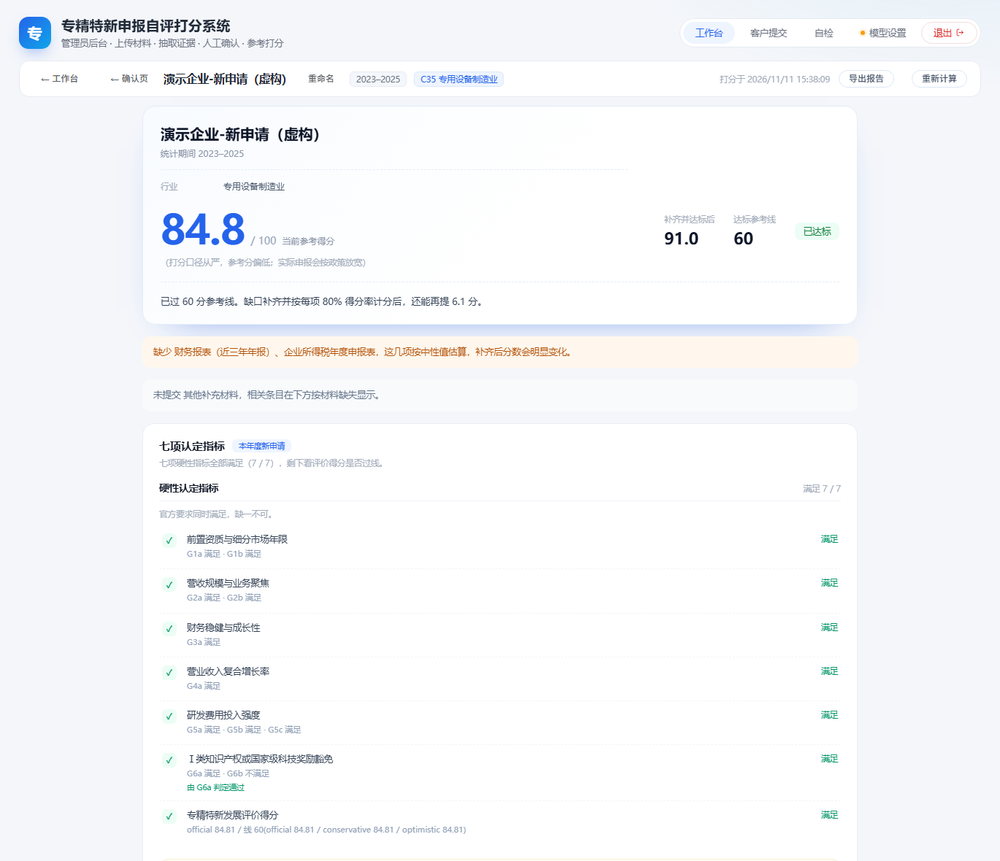
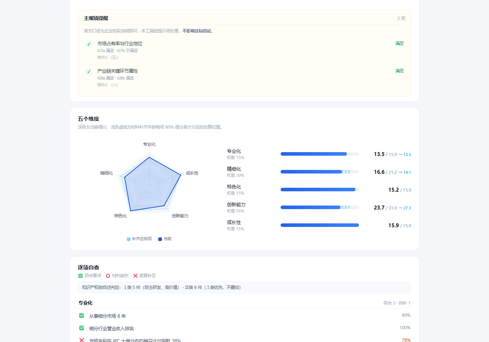
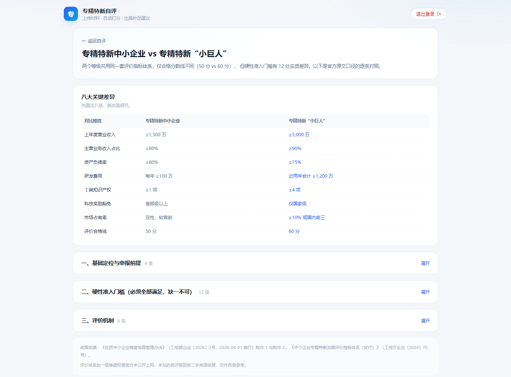
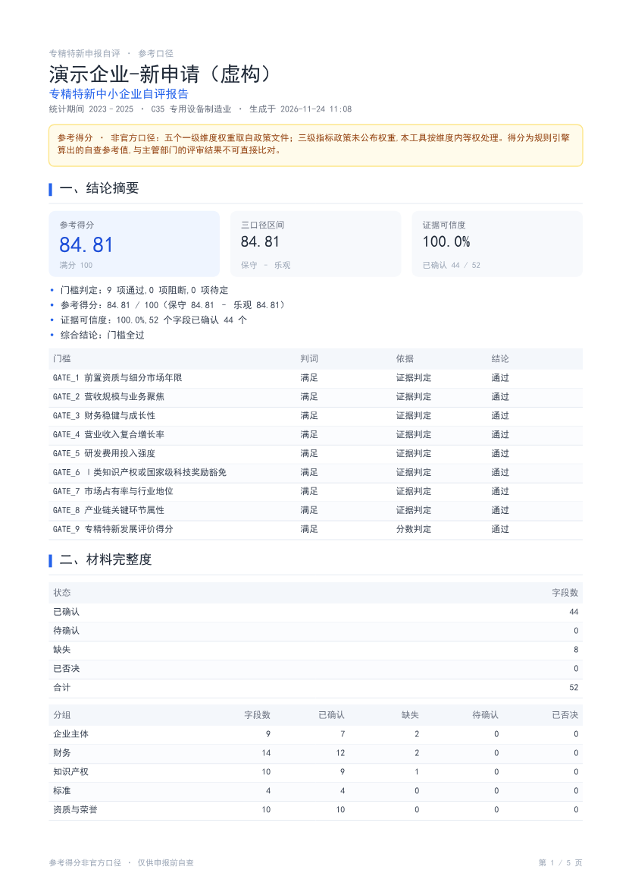
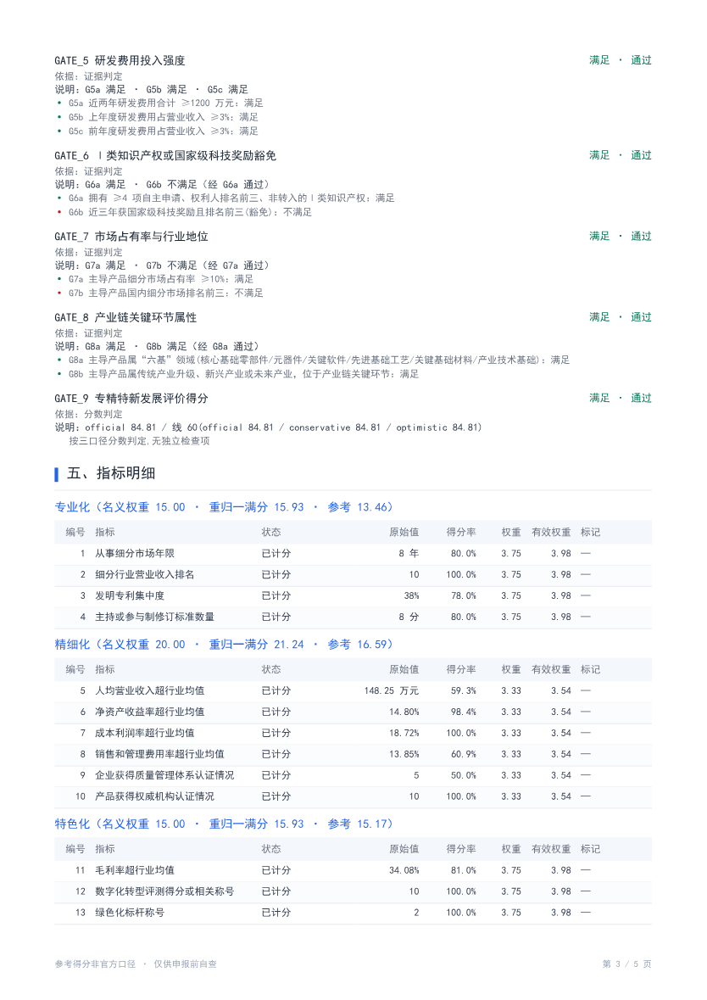
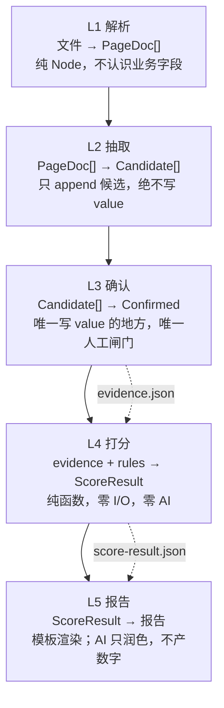

<div align="center">
  
  <h1>专精特新「小巨人」申报自评打分系统</h1>
  <p><b>上传企业材料 → 自动抽取证据 → 按官方认定标准逐条判定 9 道门槛 → 输出「差什么、补什么」</b></p>
</div>

<p align="center">
  <a href="LICENSE"></a>
  <a href="actions/workflows/ci.yml"></a>
  
  
  
  
  
  
</p>

---

> **English summary**
>
> A self-assessment tool for China's **专精特新「小巨人」(Little Giant) SME** certification.
> Upload company documents (PDF / Word / Excel) → the system extracts **52 evidence fields** →
> a **pure-function rule engine** evaluates **9 official certification gates** (7 hard + 2 advisory) →
> you get a scored report plus a prioritized list of *what is missing and how to fix it*.
>
> **Stack:** Vue 3 + TypeScript + Vite + Element Plus + ECharts · Express 5 · PDFKit · pdfjs-dist · pnpm workspaces.
> **Storage:** plain filesystem — no database, no ORM, no multi-tenancy.
> **Not an official tool.** Output is a self-check reference; the official score is computed by the cultivation platform.

---

## 目录

- [它解决什么问题](#它解决什么问题)
- [核心原则](#核心原则)
- [界面一览](#界面一览)
- [九道门槛](#九道门槛)
- [打分模型](#打分模型)
- [系统架构](#系统架构)
- [技术栈](#技术栈)
- [快速开始](#快速开始)
- [常用命令](#常用命令)
- [目录结构](#目录结构)
- [测试](#测试)
- [部署](#部署)
- [它不做什么](#它不做什么)
- [政策依据](#政策依据)
- [免责声明](#免责声明)
- [参与贡献](#参与贡献)

---

## 它解决什么问题

小巨人认定是**七项指标必须同时满足**的硬条件制。实务里最常见的失败不是分数不够，而是：

- 某一项硬指标差一点点（营收 4800 万、Ⅰ类知识产权 3 项、研发两年合计 1150 万）
- 材料齐全，但关键数字散落在审计报告第 37 页的表格里，没人逐条核对
- 自己估的和主管部门算的不是一回事

本项目把这三件事自动化：解析材料 → 抽取 52 个字段 → 人工确认 → 纯函数规则引擎判定门槛与打分。

## 核心原则

> **AI 只抽取证据、只写建议。分数由纯函数规则引擎计算。**

理由是可复现、可追溯、可校准。让模型直接给分，这三条一条都做不到。

规则引擎零 I/O、零网络、零随机数，同一份证据永远得到同一个结果，并且有 golden 快照测试锁住。

## 界面一览

**客户填报页** —— 企业信息、申报类型、8 个材料槽位，缺哪项当场标红。



**登录页**



**结果页（上）** —— 九道认定指标逐条给判定与依据，五个维度给出权重与得分率。



**结果页（下）** —— 23 项指标逐条列出原始值、得分率、权重与有效权重，并给出补足建议。



**与「专精特新中小企业」口径的差异对照**



**PDF 自评报告** —— 封面 + 结论摘要 + 门槛逐条依据 + 指标明细 + 待补材料清单。





> 完整示例报告：[<samples/自评报告-示例.pdf>](samples/自评报告-示例.pdf)（虚构企业数据）

## 九道门槛

| ID | 门槛 | 强度 | 判定要点 |
|---|---|---|---|
| GATE_1 | 前置资质与细分市场年限 | 硬 | 专精特新中小企业称号 + 细分市场 ≥3 年 |
| GATE_2 | 营收规模与主业聚焦 | 硬 | 营收 ≥5000 万 **且** 主营占比 ≥90% |
| GATE_3 | 财务稳健与成长性 | 硬 | 资产负债率 ≤75% |
| GATE_4 | 营业收入复合增长率 | 硬 | 复合增长率 ≥5%（复核类型豁免） |
| GATE_5 | 研发费用投入强度 | 硬 | 近两年合计 ≥1200 万 + 每年占比 ≥3% |
| GATE_6 | Ⅰ类知识产权或国家级科技奖励 | 硬 | Ⅰ类 ≥4 项（不含转入）或国家级奖励 |
| GATE_7 | 市场占有率与行业地位 | **提示项** | 市占率 ≥10% 或国内前三 |
| GATE_8 | 产业链关键环节定位 | **提示项** | 六基 / 产业链关键环节 |
| GATE_9 | 专精特新评价得分 | 硬 | official 口径 ≥60 分 |

**提示项不影响达标结论**，只在结果页单列提醒。官方附件明确「企业如实说明即可」，本工具不作否决——做成硬性否决会系统性误伤材料齐全但没写说明的企业。

门槛与分数完全独立：**硬门槛不过，分数再高也没用**；硬门槛全过，分数不到 60 一样不通过。

## 打分模型

三层判定：

```text
第一层  九项门槛   逐条 pass / fail / unknown / pending
                  7 道硬门槛全过才有资格；2 道提示项不参与结论
第二层  23 项得分  加权求和，得三口径区间
第三层  得分门槛  GATE_9 用 official 判是否 ≥60 分
```

| 维度 | 权重 | 项数 |
|---|---|---|
| 专业化 | 15 | 4 |
| 精细化 | 20 | 6 |
| 特色化 | 15 | 4 |
| 创新能力 | 35 | 6 |
| 成长性 | 15 | 3 |

约 42 分（行业均值类、第三方不可得类指标）无法确证，所以打分输出 **conservative / official / optimistic 三口径区间**，而不是一个假装精确的数字。

## 系统架构

五层解耦，跨层只认两份 JSON 契约：



- `evidence.json`（L3 输出 / L4 输入）
- `score-result.json`（L4 输出 / L5 输入）

两份都有 JSON Schema，任何一层改结构必须过 schema 校验与 golden test。

## 技术栈

| 层 | 选型 | 说明 |
|---|---|---|
| 前端 | Vue 3 + TypeScript + Vite + Element Plus + ECharts | 页面 90% 是表格与表单 |
| 后端 | Express 5 + TypeScript | 评分引擎与前端共享 |
| 存储 | 纯文件系统（`data/`） | 无数据库、无 ORM |
| 解析 | pdfjs-dist + mammoth + xlsx | PDF / Word / Excel 混合材料 |
| 报告 | PDFKit | 客户端与服务端共用渲染管线 |
| 测试 | Vitest | shared 162 项 + server 158 项 |

三条定死的决策：

1. **后端 Node 而不是 Python** —— 评分引擎要前后端共享，前端调参可以实时重算。止损点：3 份真实材料实测 pdfjs 表格准确率 < 70% 才换 Python。
2. **前端 Vue 3 而不是 React** —— 页面 90% 是表格与表单，Element Plus 主场。
3. **门槛与分数分离** —— 见上。

补充约束：零注释、仅桌面端、不用 axios（统一 fetch）、不引入 Pinia、CSS 一律 scoped。

## 快速开始

环境要求 Node ≥ 20.11，包管理用 pnpm。

```bash
pnpm install
pnpm start        # 构建前端并启动，http://localhost:8788
pnpm dev          # 开发模式：服务 8788 + 前端 5181
```

抽取字段需要模型接口。启动后点右上角「模型设置」填 API 地址与 Key，保存即生效，不用重启。也可以用环境变量兜底（页面配置优先级更高）：

```bash
cp .env.example .env
# 编辑 .env，填 AI_API_KEY
```

想先看效果，不想自己配模型：`samples/` 里有 5 份虚构企业材料，灌进去就能跑通全流程。

## 常用命令

| 命令 | 作用 |
|---|---|
| `pnpm validate` | 配置校验 + 三包类型检查 + 全部测试，**提交前必跑** |
| `pnpm test` | 只跑测试（shared + server） |
| `pnpm typecheck` | 三包类型检查 |
| `pnpm build` | 构建前端到 `web/dist` |
| `pnpm check:font` | 中文字体自检，PDF 导出前必跑 |
| `pnpm samples` | 重新生成 `samples/` 里的虚构企业材料 |

## 目录结构

```
docs/       方案文档（PLAN.md 是主文档）+ 架构、打分、解析三篇
deploy/     宝塔部署手册 + nginx/PM2 配置 + 更新/备份/回滚脚本
config/     规则包、字段目录、行业基准、客户流程参数
shared/     零依赖纯函数：打分引擎 + JSON Schema + 指标实现
server/     Express 服务：解析链路 / AI 抽取 / 存储 / 报告
web/        Vue 3 前端：管理端 + 客户轻流程
samples/    虚构企业材料样本 + 示例报告（可直接灌进去跑通全流程）
assets/     品牌图标
data/       运行时数据，永不入库
```

改规则参数只改 `config/rules/`，不改代码。改完必须跑 `pnpm validate`。

## 测试

```bash
pnpm validate
```

三道闸：规则包配置校验 → 三包类型检查 → 全部单元测试（shared 162 + server 158）。

GitHub Actions 在 **Linux 与 Windows 两个平台**都跑同一套校验，字体解析、路径处理这类平台差异会被 CI 挡住。

## 部署

一台服务器、一个 Node 进程、一个共享账号。**不是多租户方案**，所有访问者看到同一份数据。

- 手把手教程：[<deploy/宝塔部署教程.md>](deploy/宝塔部署教程.md)
- 参数速查手册：[<deploy/README.md>](deploy/README.md)

日常更新只有一条命令，会自动先备份、再同步、失败自动回滚：

```bash
cd /www/wwwroot/lgi
bash deploy/update.sh
```

| 要做的事 | 命令 |
|---|---|
| 同步本地最新代码（自动备份，失败自动回滚） | `bash deploy/update.sh` |
| 手动存一份快照 | `bash deploy/backup.sh` |
| 列出所有快照 | `bash deploy/rollback.sh --list` |
| 回滚到上一份 | `bash deploy/rollback.sh` |

备份分两类，互不干扰：`lgi-code-*.tar.gz`（代码，每次更新一份）与 `lgi-data-*.tar.gz`（`data/` 数据）。`data/` 不在版本库里，更新不会覆盖，但删目录重传会。

## 它不做什么

- **不承诺与官方评分一致**。维度权重官方未公开，规则包中的 15/20/15/35/15 为二手来源。
- 不替代申报材料准备。
- 不做多账号、多租户。
- 不做联网检索，材料给什么算什么。

## 政策依据

- 《优质中小企业梯度培育管理办法》工信部企业〔2026〕2号，2026-04-01 施行。附件 2 是小巨人认定标准，七项指标必须同时满足。[原文链接](https://www.miit.gov.cn/zwgk/zcwj/wjfb/tz/art/2026/art_5546b1a622ea4d73bd2ca395b73bd4eb.html)
- 《中小企业专精特新发展评价指标体系（企业）（试行）》工信厅企业〔2024〕75号。**该文附件表与各维度权重均未公开上网**，规则包中的权重为二手来源，详见 [<docs/scoring.md>](docs/scoring.md)。

## 免责声明

本工具输出为**自查参考**，非官方评分。维度权重与三级指标权重均未官方公开，参考得分不可用于申报材料中的自评分数填报。

最终认定以培育平台计算与主管部门审核结果为准。

## 参与贡献

欢迎提 issue 与 PR。开始之前请读 [<CONTRIBUTING.md>](CONTRIBUTING.md)，里面写清了硬性规则、`pnpm validate` 要求和分支约定。

- 行为准则：[<CODE_OF_CONDUCT.md>](CODE_OF_CONDUCT.md)
- 安全问题反馈：见 [<SECURITY.md>](SECURITY.md)，**请勿公开提 issue**
- 变更记录：[<CHANGELOG.md>](CHANGELOG.md)
- 提交 issue：[<new issue>](https://github.com/Canscx/lgi-scorer/issues/new/choose)

## 许可

[Apache License 2.0](LICENSE) © 2026 Canscx